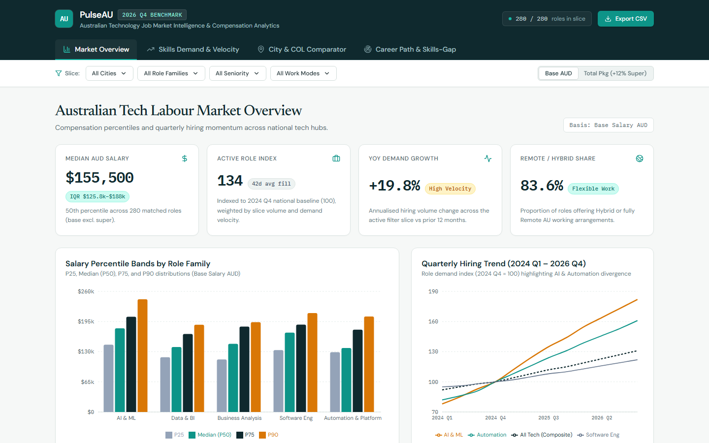
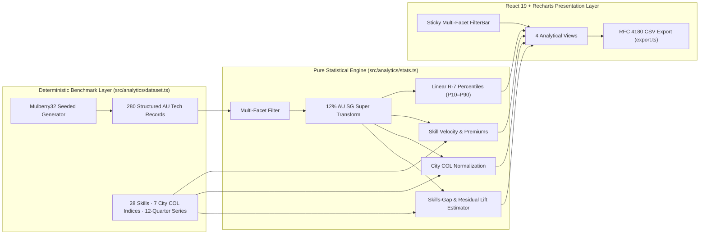

# PulseAU — Australian Tech Job Market Intelligence & Compensation Analytics

PulseAU is a client-side labour-market intelligence and compensation analytics platform for the Australian technology sector. It enables engineering leaders, hiring managers, and practitioners to slice compensation percentiles, compare real purchasing power across Australian cities, track high-velocity technical skills, and model role readiness and AUD salary lift.



## Key Capabilities

- **Global Multi-Facet Slicing**: Filter every analytical view simultaneously by City/State (`Melbourne`, `Sydney`, `Brisbane`, `Perth`, `Adelaide`, `Canberra`, `Remote AU`), Role Family (`AI & ML Engineering`, `Data Analytics & BI`, `Business Analysis`, `Software Engineering`, `Automation & Platform`), Seniority (`Graduate`, `Mid-Level`, `Senior`, `Lead / Principal`), Work Mode (`Hybrid`, `Remote`, `On-site`), and Compensation Basis (`Base AUD` vs `Total Package incl. 12% Super`).
- **Market Overview**: Executive KPI strip (Median AUD Salary with IQR, Active Role Index, YoY Demand Growth, Remote/Hybrid Share), P25/P50/P75/P90 salary percentile bands by role family, and a 12-quarter hiring demand series (`2024 Q1 – 2026 Q4`).
- **Skills Demand & Velocity Quadrant**: Interactive scatter quadrant mapping 28 technical and BA skills across demand share, YoY growth rate, and median AUD salary premium, paired with a sortable ledger.
- **City & Cost-of-Living Comparator**: Side-by-side comparison of nominal AUD medians vs Sydney-indexed (`COL = 100`) purchasing power, median weekly rent, flexible work share, and dominant role families.
- **Career Path & Skills-Gap Analyser**: Interactive role readiness calculator and seniority-controlled residual salary-lift estimator for missing core skills.
- **One-Click CSV Export**: RFC 4180 CSV export of the currently filtered market slice reflecting the active compensation basis.

## Architecture



## Methodology & Synthetic Benchmark Disclosure

> **Data Transparency**: PulseAU operates on a **deterministic synthetic benchmark dataset** (280 structured records across 7 Australian markets, 5 role families, 4 seniority bands, and 28 skills) modelled on publicly reported Australian technology hiring distributions. It does **not** scrape, store, or redistribute proprietary job-board listings.

- **Percentiles**: Computed using exact Hyndman–Fan Type 7 (R-7) linear interpolation (`rank = (p / 100) * (n - 1)`), matching R, NumPy, and Excel `PERCENTILE.INC`.
- **Superannuation Guarantee**: Toggling `Total Pkg (+12% Super)` applies the statutory **12.0%** Australian Superannuation Guarantee rate (effective 1 July 2025).
- **Cost-of-Living Normalization**: Sydney is anchored at `COL = 100.0`. Each city's Sydney-equivalent purchasing power is computed as `nominalMedian / (colIndex / 100)`, and its Purchasing Power Index is indexed relative to Sydney's baseline (`100.0`).
- **Skills-Gap Salary Lift**: Rather than comparing raw averages (which are confounded by seniority), the estimator residualizes each record's compensation against its seniority group mean within the target role family, then applies empirical-Bayes shrinkage toward structural skill priors so small filter slices remain stable.

## Technical Decisions

- **Pure, Framework-Free Analytics Module (`src/analytics/`)**: All statistical calculations, filtering, and CSV serialization are pure TypeScript functions with zero React dependencies, making them fast to test in Node via Vitest and straightforward to swap onto a live warehouse API later.
- **Deterministic Seeded Data**: A seeded Mulberry32 PRNG ensures identical benchmark numbers across sessions, builds, and CI runs.
- **Static Deployment (`base: './'`)**: Configured for zero-backend deployment to GitHub Pages via `.github/workflows/deploy.yml`.

## Local Development

```bash
# Install dependencies
pnpm install

# Start local dev server
pnpm run dev

# Typecheck
pnpm run typecheck

# Run unit tests
pnpm test

# Production build
pnpm run build
```

## Testing

Unit tests live in `src/analytics/__tests__/` and verify:
- Dataset coverage across all 7 cities, 5 role families, and 28 skills
- Exact R-7 linear-interpolation percentiles and edge cases
- 12% Superannuation Guarantee scaling across KPIs and exports
- Multi-facet filtering invariants
- City COL purchasing-power normalization
- Skills-gap readiness scoring and residualized AUD lift monotonic behaviour
- RFC 4180 CSV export headers and compensation basis formatting

## License

MIT — see [LICENSE](./LICENSE).
